# Arquitetura da solução

## Decisão arquitetural proposta

O PromptShield BR é uma camada independente de detecção, posicionada entre conteúdo externo e o agente consumidor. O consumidor mantém responsabilidade pela ação: a API devolve sinal de risco e decisão, mas não concede permissões ao agente nem executa ações em seu nome. A proposta respeita o limite do Challenge: classificação por modelos discriminativos, sem LLM generativo em inferência.

```mermaid
flowchart LR
  X[Fontes externas\ne-mail, web, documento, RAG, imagem/PDF] --> C[Consumidor automatizado]
  C --> E{Texto nativo?}
  E -- não --> O[Extração/OCR\nserviço independente]
  E -- sim --> N[Normalização e metadados]
  O --> N
  N --> G

  subgraph ENV[Ambientes futuros: desenvolvimento → homologação → produção]
    G[FastAPI / API Gateway\nTLS, X-API-Key, rate limiting] --> V[Validação de contrato\ne limite de payload]
    V --> M[Serviço de classificação\nRegex / TF-IDF / DeBERTa]
    M --> P[Política de decisão\nALLOW / REVIEW / BLOCK]
    P --> R[Registro de eventos\nminimizado e versionado]
    R --> DB[(Banco de dados\nSQLite dev → PostgreSQL hml/prod)]
    P --> A[Resposta estruturada]
    DB --> AD[API administrativa segregada\nOIDC/MFA + RBAC]
    AD --> PORTAL[Portal administrativo]
  end

  A --> C
  PORTAL --> H[Revisão humana e curadoria]
  H --> D[Dataset aprovado\npara ciclo futuro de modelo]
```

Regex, TF-IDF e DeBERTa são versões/alternativas de comparação, não etapas obrigatórias de uma cascata. As setas de registro e resposta não autorizam resposta de sucesso antes da persistência necessária: falha de banco segue a política explícita de indisponibilidade. A normalização linguística usada na inferência pertence ao pipeline versionado do motor; a extração prévia prepara texto e metadados sem substituir esse processamento.

## Componentes e responsabilidades

| Componente | Responsabilidade proposta | Justificativa |
|---|---|---|
| Consumidor/RAG | Extrair origem, chamar API antes de compor contexto e aplicar decisão. | Mantém integração desacoplada e separa conteúdo não confiável. |
| Extração/OCR | Converter imagem/PDF em texto, confiança e referências de página. | Uniformiza a entrada do motor; falha de OCR não é autorização. |
| FastAPI/API Gateway | Expor contrato, autenticar consumidores, limitar recursos e correlacionar requisições. | FastAPI oferece esquemas de segurança integrados ao OpenAPI, incluindo `apiKey` ([documentação](https://fastapi.tiangolo.com/tutorial/security/)). |
| Serviço de classificação | Executar regras, TF-IDF ou DeBERTa discriminativo em CPU. | Permite substituir versão sem alterar contrato. |
| Política de decisão | Converter score/classificação em decisão versionada. | Separa modelo de tolerância operacional a erro. |
| Banco de eventos | Guardar eventos minimizados, versões, revisão e auditoria. | Sustenta portal e governança sem depender de texto bruto. |
| Portal/API administrativa | Exibir métricas e permitir revisão por papel. | Mantém operações humanas fora da API de consumidores. |

## Infraestrutura e ambientes futuros

| Tema | Proposta | Estado |
|---|---|---|
| Framework de API | FastAPI, por contrato OpenAPI, validação e integração de esquemas de segurança. | Arquitetura proposta; não implementada. |
| Classificador | Processo/serviço separado da camada HTTP, com interface interna versionada. | Arquitetura proposta; não implementada. |
| Banco | SQLite para desenvolvimento individual; PostgreSQL para homologação e produção, após validação de concorrência, backup e acesso. | Migração proposta; não implementada. |
| OCR | Serviço lógico independente, invocado antes do motor; processamentos extensos podem migrar para fila assíncrona futura. | Arquitetura proposta; não implementada. |
| Containers | Imagens imutáveis por componente, com configuração externa e sem segredos embutidos. | Estratégia futura; containers simplificam build/deploy, não são controle de segurança por si ([FastAPI](https://fastapi.tiangolo.com/deployment/docker/)). |
| Ambientes | Desenvolvimento com dados sintéticos; homologação com testes controlados; produção somente após aprovações de dados, segurança e operação. | Requer governança institucional. |

## Autenticação, autorização e segregação

- **Consumidor:** API Key no header `X-API-Key`, vinculada a cliente, escopo e limite. A chave identifica aplicação, não usuário humano; a OWASP recomenda API Keys apenas para autenticação de clientes de API, não de usuários ([API2:2023](https://api-security.owasp.org/editions/2023/en/0xa2-broken-authentication/)).
- **Administração:** autenticação federada futura por OIDC/OAuth 2.0 com MFA e tokens de curta duração; nunca API Key de consumidor. A escolha do IdP depende de aprovação institucional.
- **RBAC:** analista consulta eventos minimizados; revisor cria feedback; administrador técnico administra configuração sem ler conteúdo; administrador funcional gerencia papéis; nenhum papel obtém acesso implícito a tudo.
- **Segregação:** `/v1/analyze` é API de consumo; `/v1/admin/*` exige autenticação administrativa, RBAC e pode ser exposta em domínio/rede separados em produção. O portal usa somente a superfície administrativa.
- **Recursos:** rate limit e limites de tamanho protegem contra consumo irrestrito, risco listado pela OWASP para APIs ([API Top 10](https://devguide.owasp.org/en/07-training-education/07-api-top-ten/)).

## Confiabilidade e resiliência

| Condição | Comportamento proposto |
|---|---|
| JSON/campo malformado ou payload excedido | Rejeitar antes do motor com erro 400/413, sem ecoar conteúdo. |
| Timeout/indisponibilidade do classificador | Retornar 503 com `request_id`; não emitir `ALLOW` por ausência de análise. |
| Falha ou baixa confiança de OCR | O consumidor retém para revisão antes da API quando não houver texto confiável; não fabrica resposta de análise. Texto vazio/inválido enviado à API recebe erro 400/422, sem `decision`. |
| Falha transitória de rede | Consumidor usa `Idempotency-Key` e no máximo duas tentativas com backoff; nunca reprocessa ação sensível sem confirmação. |
| Banco indisponível | Não confirmar análise como auditada; degradar para resposta explícita de indisponibilidade ou retenção, conforme política aprovada. |
| Ação sensível no consumidor | Diante de `REVIEW`, `BLOCK` ou erro, reter e exigir aprovação humana; não fazer *fail-open*. |

Recuperação inclui health checks separados de prontidão, limite de concorrência, logs sem texto bruto, alertas, última versão de modelo aprovada e plano de rollback. Valores operacionais estão definidos como metas preliminares em 11 e exigem teste futuro.

## Política de decisão

1. **Classificação de conteúdo:** saída semântica do motor, por exemplo `benign` ou `injection`; não é decisão operacional.
2. **Score do detector:** evidência numérica de risco. `heuristic_risk` não é probabilidade; `calibrated_probability` só pode ser usado após calibração validada.
3. **Thresholds:** parâmetros `allow_threshold` e `block_threshold` na escala 0–100 e versionados na política, com `0 ≤ allow_threshold < block_threshold ≤ 100`. Na regra-base proposta, score abaixo de `allow_threshold` permite `ALLOW`; de `allow_threshold` inclusive até `block_threshold` exclusive implica `REVIEW`; a partir de `block_threshold` inclusive implica `BLOCK`. Restrições de origem/ação podem impor retenção adicional; valores numéricos ainda dependem de validação.
4. **Decisão:** `ALLOW` permite encaminhar sob controles; `REVIEW` retém para análise; `BLOCK` impede encaminhamento. A decisão incorpora política, não apenas modelo.

Thresholds serão escolhidos em validação futura por curvas precision-recall/calibração, custo de falso negativo, custo de falso positivo, capacidade humana de `REVIEW` e criticidade de `source_type`. Não há threshold nem performance aprovados nesta Sprint.

## Modelo profundo e estratégia de comparação

DeBERTa é candidato por ser Transformer de encoder adequado a classificação contextual; atenção relaciona tokens na entrada, diferentemente de regras ou contagem de n-gramas. O ponto de partida documentado é treinado com idiomas inglês e alemão declarados na card, portanto não é evidência de qualidade em PT-BR. O ciclo futuro mede zero-shot, compara baseline Regex e TF-IDF sob o mesmo teste congelado, ajusta dados PT-BR licenciados/revisados e avalia LoRA contra fine-tuning completo.

CPU é uma hipótese de viabilidade, não garantia: limites de tokens, chunking, memória, p95 e throughput devem ser medidos no ambiente-alvo. Nenhum texto longo será truncado silenciosamente; o agregador registra chunk e versão responsáveis pelo maior risco.
