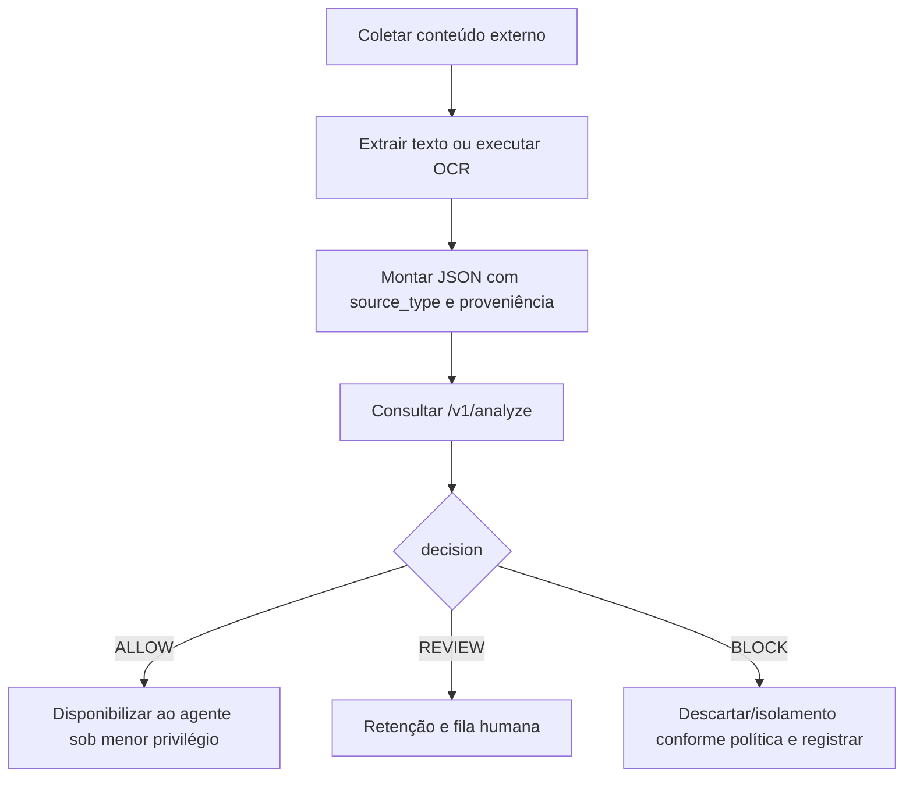

# Consumidor automatizado, OCR e RAG simulado

## Consumidor automatizado proposto

O consumidor é um robô ou integração que coleta conteúdo externo, padroniza-o em JSON e consulta `POST /v1/analyze` **antes** de apresentar esse conteúdo ao agente. Ele não executa o modelo nem precisa conhecer a implementação do motor.

| Origem | Extração proposta | `source_type` | Ação posterior |
|---|---|---|---|
| Texto direto | Texto do usuário com origem preservada. | `user_text` | Aplicar decisão antes de encaminhar ao agente. |
| E-mail | Corpo, assunto e anexo com proveniência separada. | `email` | Prosseguir, reter ou descartar conforme decisão. |
| Web | Texto visível e contexto de URL/DOM permitido. | `web_page` | Reter conteúdo de alto risco antes de contexto do agente. |
| Documento | Texto nativo por seção/página. | `document` | Analisar antes de indexar ou resumir. |
| RAG | Chunk recuperado, documento e ordem. | `rag_chunk` | Não montar chunk bloqueado no contexto. |
| Imagem/PDF | OCR com confiança e referência ao arquivo. | `image_ocr`/`pdf_ocr` | Encaminhar texto extraído à API. |

## OCR de imagens e PDFs digitalizados

O fluxo futuro propõe Tesseract com pacote de idioma português, pois é um mecanismo OCR aberto, documentado e licenciado sob Apache-2.0 ([Tesseract documentation](https://tesseract-ocr.github.io/tessdoc/)). OpenCV é proposto somente como pré-processamento visual; sua efetividade deve ser validada com corpus representativo, não presumida.

Etapas: validar tipo/tamanho do arquivo; rasterizar PDF quando não houver camada textual; corrigir orientação; converter para escala de cinza; testar contraste/adaptive thresholding; reduzir ruído; ampliar resolução para texto pequeno; executar OCR; capturar confiança e bounding boxes; encaminhar texto, origem e metadados ao detector. A camada textual de PDF deve ser preferida quando existente, preservando a indicação de origem.

Texto oculto, de baixo contraste ou sobreposto exige duas precauções: analisar a imagem original e versões pré-processadas, e reter no consumidor para revisão os casos com baixa confiança ou discrepância relevante entre passagens. Essa revisão anterior à classificação não é resposta `decision=REVIEW` da API; quando não há texto válido, o consumidor não consulta o motor, ou recebe erro se enviar entrada inválida. O OCR não deve ser usado para reconstruir ou tornar público conteúdo sensível: evidências visuais ficam protegidas por RBAC e retenção.

| Caso ilustrativo | Tratamento esperado |
|---|---|
| Imagem de comprovante com frase pequena “ignore controles” em cinza claro. | OCR em passagem de contraste, `source_type=image_ocr`, possível retenção. |
| PDF digitalizado com instrução no rodapé. | OCR por página, manter página/offset e agregar o maior risco. |
| Banner legítimo: “Ignore o aviso anterior; a manutenção foi concluída.” | Hard negative: contexto operacional legítimo, não bloqueio automático. |
| Manual que cita ataques de prompt injection. | Hard negative; citação/explicação não é necessariamente instrução ao agente. |

## RAG simulado

Para demonstrar injeção indireta sem dados reais, a Sprint futura pode usar uma base sintética de políticas, FAQs e procedimentos fictícios. Alguns documentos terão chunks contaminados explicitamente marcados apenas no dataset de avaliação. Cada chunk recuperado será enviado individualmente à API como `rag_chunk`; o orquestrador monta o contexto do agente somente com chunks `ALLOW`, e encaminha `REVIEW` para fluxo humano. Esse cenário avalia a origem RAG sem afirmar integração com EvaGPT.
