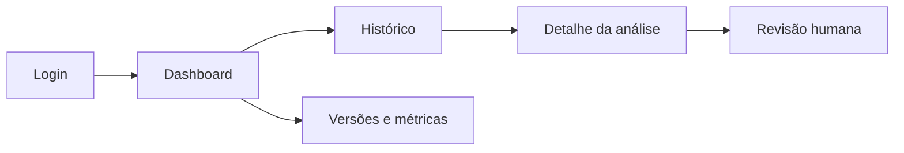

# Wireframes estáticos do portal administrativo

## Navegação proposta



## Login

```text
+--------------------------------------------------+
| PromptShield BR                                  |
|                                                  |
|           [ Entrar com identidade corporativa ]  |
|                                                  |
| Redirecionamento ao IdP OIDC; MFA no provedor      |
| Suporte institucional                            |
+--------------------------------------------------+
```

Fluxo proposto: redirecionar ao IdP corporativo OIDC e retornar com sessão autorizada por RBAC; MFA ocorre no provedor. O portal não coleta senha local. O IdP depende de decisão institucional. Erros são genéricos e não revelam existência de conta.

## Dashboard

```text
+----------------------------------------------------------------+
| Dashboard | Histórico | Revisões | Modelos                    |
| Período [____] Origem [todas v] Modelo [todas v]              |
| [Análises] [ALLOW] [REVIEW] [BLOCK] [Latência p95*]            |
|                                                                |
| Decisões por dia                 | Métricas por versão*       |
| [gráfico estático planejado]      | [precision/recall/F1]     |
|                                                                |
| *Somente após medição válida.                                  |
+----------------------------------------------------------------+
```

Indicadores previstos: volume, distribuição de decisões, `REVIEW rate`, precision, recall, F1, falsos positivos, latência e cobertura por origem/versão. O portal distingue métrica medida, período e denominador de previsão ou meta.

## Histórico

```text
+----------------------------------------------------------------+
| Histórico de análises                                            |
| Data [____] Decisão [v] Origem [v] Modelo [v] Score [___]       |
| ID          origem     decisão  score  versão    revisado        |
| anl_...     email      BLOCK    92     rules...  não             |
| anl_...     rag_chunk  REVIEW   48     deberta.. sim             |
| [Anterior] 1 2 3 [Próxima]                                      |
+----------------------------------------------------------------+
```

Filtros incluem período, `source_type`, decisão, `model_version`, `policy_version`, status de revisão e faixa de score. A lista mostra metadados minimizados, não conteúdo integral por padrão.

## Detalhe e revisão humana

```text
+----------------------------------------------------------------+
| Análise anl_...                         decisão BLOCK           |
| Origem: email | score: 92 (heuristic_risk) | modelo: rules-0.1   |
| Reason codes: instruction_override, unauthorized_data_request   |
| Conteúdo protegido: [solicitar acesso justificado]               |
| Trilha: recebido > classificado > política > revisão             |
| [Criar revisão]                                                  |
+----------------------------------------------------------------+

+----------------------------------------------------------------+
| Revisão humana                                                    |
| Rótulo: ( ) benigno ( ) direta ( ) indireta ( ) inconclusivo    |
| Decisão recomendada: [ALLOW/REVIEW/BLOCK v]                      |
| Motivo e evidência: [____________________________________]      |
|                         [ Salvar revisão ]                       |
+----------------------------------------------------------------+
```

A revisão cria um novo registro, com identidade do revisor, data, versão observada e justificativa. Ela não altera silenciosamente a saída original nem entra automaticamente em treino; curadoria e aprovação posteriores são obrigatórias.

## Correspondência com contrato e estados da interface

| Tela | Endpoint administrativo proposto | Dados e controles |
|---|---|---|
| Dashboard | `GET /v1/admin/metrics` | Agregados, janela, denominador, versões e origem; sem texto bruto. |
| Histórico | `GET /v1/admin/analyses` | Paginação, filtros e minimização conforme contrato. |
| Detalhe | `GET /v1/admin/analyses/{analysis_id}` | Saída original, versões e trilha; conteúdo excepcional depende de retenção e autorização. |
| Revisão | `POST /v1/admin/analyses/{analysis_id}/review` | Rótulo humano, motivo e decisão recomendada em registro adicional. |
| Versões e métricas | `GET /v1/admin/model-versions` e `GET /v1/admin/metrics` | Comparar versões com a janela/conjunto de avaliação informados. |

Login ocorre no IdP, não em endpoint fictício de senha local. Os números e versões dos wireframes são placeholders ilustrativos. Antes de dados medidos, mostrar estado vazio, nunca métricas fictícias; distinguir carregamento, indisponibilidade e acesso negado. O vínculo entre nomes visuais e `label`/`classification` segue o documento 04. Não há protótipo implementado.
